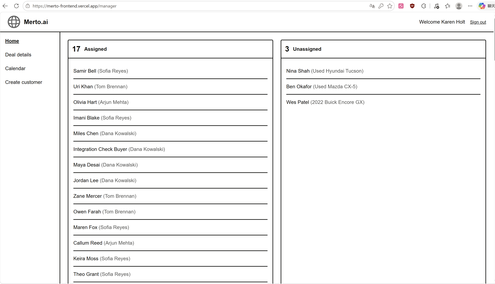
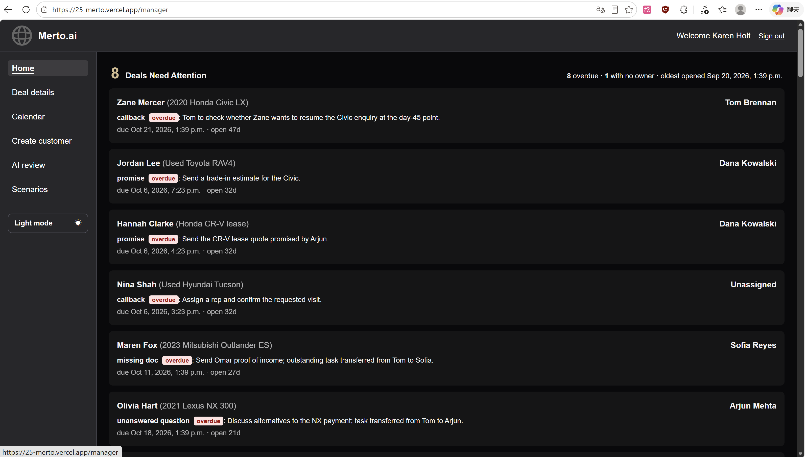

# Merto/TEAM 25

## 1. What Needed to Improve

After D2 the app covered the basic workflows for managers and representatives: creating, editing, and viewing deals. Three gaps stood out. First, our partner said at the D2 demo that the interface should be more user-friendly and match Merto’s brand. Second, our review of AI replies depended on keyword rules, and on our held-out test set the regex detector matched only 559 of 960 messages (58.2%), so reworded messages slipped through. Third, there was no search across deals, appointment requests were not surfaced to the people who had to confirm them, and there was no automated testing or deployment of the live demo.

We found these from three sources: the partner’s feedback at the D2 demo, our own team reflection after D2, and measuring the D2 evaluator against a labeled dataset. Because Merto ([Merto.ai](http://Merto.ai)) is built around AI, we made the evaluator our headline improvement and worked on the other gaps in parallel.

Our solution in D3 to the deterministic shortcomings in D2 was to improve our reviewer by using AI. The AI reads the context of the messages and alerts the general manager when a reply was judged to be inappropriate. The use of the AI model, as well as the deterministic rules, increased the number of situations the reviewer could handle, while bringing our product more in-line with Merto’s brand.

## 2. What You Did

### Appointment Tracking & Calendar Interface

We implemented a new Calendar tab that allows dealership employees to manage and keep track of customer appointments throughout the sales process. General Managers and sales representatives can create, view, and edit appointments. General Managers can view appointments across all representatives or filter by a specific representative, as well as access a summary of unconfirmed appointment requests with details such as customer information, assigned representative, and requested date. Sales representatives can find appointments requiring their confirmation on their dashboard. Additionally, when a General Manager transfers a deal from one sales representative to another, any previously confirmed appointments associated with that deal are automatically changed back to a requested status. The newly assigned representative must review and confirm them.

Implementation: [Calendar PR #27](https://github.com/csc301-2026-f/25-Merto/pull/27).

### Search Bar Functionality

We implemented the ability for users to search their list of deals for specific fields (by assigned representative, vehicle of interest, etc).

Originally, the search bar code was written to be copy pasted into the file for each view that needed a search bar. We realized quickly that it would make a lot more sense to extract the code into its own component file to be imported into other files instead, keeping modularity in mind. Notably, adding this code to the dealership representative’s view required a change in the frontend: originally, the representative view was served by one server component React file, which we separated into server and client since we needed to use `useState` to add the search bar.

Implementation: [Search Bar PR #22](https://github.com/csc301-2026-f/25-Merto/pull/22).

### Scenario Checks

We implemented scenario checks, where a General Manager runs a predefined scenario and sees whether an AI agent did what the store expects. A manager Scenarios page lists seven scenarios from the Merto brief, such as a visit that is only requested, a vehicle the AI cannot check, and a buyer who opted out. Running one gives a scorecard with each check and its evidence, the flags raised on the agent's messages, and a step-by-step log of what the agent did. Two agents can be compared side by side, and an outside agent can be scored through the same interface.

A run loads a deal at a fixed point in time, lets the agent act through a small set of tools (reply, create a to-do, request a visit, or do nothing), scores the result, and then rolls the database transaction back. This gave us a resettable sandbox without adding any tables, and nothing a run does is saved. The scoring is deterministic: eleven checks about behavior, plus the existing evaluation rules from the AI evaluator, so the same input always gives the same result. Because the Merto brief requires the core app to work without paid API keys, no AI model is called; the two sample agents are rule-based stand-ins, one careful and one that makes the mistakes the brief warns about.

Two design decisions are worth noting. The tools enforce the store's AI mode (off blocks a reply, draft-only keeps a draft), but they do not block bad content like a price or a message to an opted-out buyer, so a bad agent fails a check instead of being silently stopped. One integration challenge was that a database transaction uses one clock, so every row would get the same timestamp and the timeline would lose its order. We gave each scenario fixed times and each agent step its own timestamp, which also made runs repeatable.

Implementation: [Scenario checks PR #18](https://github.com/csc301-2026-f/25-Merto/pull/18).

### AI Conversation Evaluation

We extended the D2 evaluator by replacing its regex-based detection of six existing message signals with fine-tuned text classifiers. AI replies are checked for booking claims, availability guarantees, price quotes and inappropriate tone; buyer messages are checked for requests for a person or pricing information. We kept the downstream deterministic business rules and database checks. For example, a booking claim only becomes an appointment flag when no earlier confirmation is recorded. This separation let us improve wording recognition while retaining the existing flag types, evidence links and manager review workflow.

We compared MiniLM, BGE-base and MPNet using a balanced synthetic dataset of 3,840 messages, split into 2,400 training, 480 development and 960 test messages. Each split balances AI and buyer messages and no-, single- and multi-signal cases. We used SetFit to fine-tune separate AI and buyer encoders for each architecture, trained multi-label logistic regression classifiers, and selected each signal's threshold using development data only. On the same test set, MPNet achieved 936/960 whole-message signal matches (97.5%), compared with 559/960 (58.2%) for regex. These results measure signal detection, not final CRM flag accuracy; the data were AI-authored and assistant-reviewed without independent human annotation.

Integration required keeping live inference consistent with offline evaluation. We retained the trained tokenization, pooling and thresholds, and verified that the deployment runtime reproduced all 2,880 test-label decisions. The CRM lets managers switch between deterministic rules and MPNet, with separate results and reviews. Memory was another constraint: we prepared a separate Python service loading only the two MPNet encoders, while keeping MiniLM and BGE as offline comparators. A controlled Linux test stayed within a 2 GiB limit at about 1.22 GB peak process memory. The model service is deployed and connected to the live app, so managers can choose between the deterministic rules and MPNet on the AI review page.

Implementation: [US5 model evaluation and live inference demo PR #17](https://github.com/csc301-2026-f/25-Merto/pull/17) and [MPNet service and trained weights PR #21](https://github.com/csc301-2026-f/25-Merto/pull/21).

### AI Reply Generation

We updated the suggested reply feature to use the Groq API instead of fixed templates. It uses the customer’s recent messages and deal information to generate an email or SMS draft, which representatives can approve, edit, or reject before recording a simulated send.

We built this on top of the existing draft review system so representatives could follow the same steps as before. Connecting an external API meant we also had to handle failed requests and cases where the deal changed after a reply was generated. We added error handling, checks for outdated drafts, and tests for the new functionality.

Implementation: [US14 PR #14](https://github.com/csc301-2026-f/25-Merto/pull/14).

### Deployment

We deployed the frontend and backend on Vercel and connected the backend to our hosted Supabase database. This allows the team and partner to try the app without setting it up locally.

For this, I forked our team’s repo and connected the fork to Vercel. Some parts of the local setup needed adjusting for deployment, particularly the database connections and requests between the frontend and backend. I updated the configuration to get these working and added demo login details and instructions to the README.

Implementation: [Deployment PR #15](https://github.com/csc301-2026-f/25-Merto/pull/15).

### CI/CD Improvements

We set up automated testing for every pull request and made deployment of the live demo fully automatic.

For CI, we added a GitHub Actions workflow that runs on every pull request and every push to main. It runs three jobs in parallel: backend typecheck and tests, frontend lint and build, and database migration and seed tests. The backend tests use an in-memory database built from our migrations, so CI never touches the hosted Supabase. A second workflow runs on pull requests that change the evaluation model, building the MPNet model container and checking its predictions under a 2 GiB memory limit.

For CD, the course org repo can’t hold secrets or connect to Vercel, which is why we deploy from the fork described above (an approach endorsed by the TAs on Piazza). Vercel redeploys the frontend and backend on every new commit to the fork, and a scheduled workflow syncs the org repo’s main branch into the fork every 15 minutes, so a merged pull request reaches the live demo with no manual steps. One limitation is that GitHub’s built-in token can’t sync commits that change workflow files, so those still need a manual sync. Supabase migrations are also still applied manually, and we plan to automate them next.

Implementation: [CI workflow commit fd2f42d](https://github.com/csc301-2026-f/25-Merto/commit/fd2f42d), [fork sync PR #20](https://github.com/csc301-2026-f/25-Merto/pull/20), [ENVIRONMENT.md PR #24](https://github.com/csc301-2026-f/25-Merto/pull/24), and [frontend env example PR #25](https://github.com/csc301-2026-f/25-Merto/pull/25).

## 3. Before vs. After

### UI/UX improvements

The manager home page before (D2, top) and after (D3, bottom):

In D3 the home page leads with the work that needs attention (overdue items and deals with no owner), the sidebar gains AI review and Scenarios, and users can switch to a light mode. The frontend as a whole was revamped with changes such as:

* better colouring  
* light / dark mode function  
* clickable buttons lighting up when hovered on  
* better navigation between pages (e.g. clicking a deal on the home page for managers now opens up to its own deal page)  
* search function

Implementation: [UI redesign PR #16](https://github.com/csc301-2026-f/25-Merto/pull/16).

### Measured improvements

Where we could measure a change, this is what it was:

| Area | Before (D2) | After (D3) | Evidence |
| --- | --- | --- | --- |
| AI evaluation | Keyword rules matched 559 of 960 held-out test messages (58.2%) | A trained MPNet model matches 936 of 960 (97.5%) and can be selected on the live AI review page | [PR #17](https://github.com/csc301-2026-f/25-Merto/pull/17) |
| Accessibility | Not measured | Lighthouse accessibility scores of 100, 100, 100, and 98 on four pages | [README, "Non-Functional Requirements"](../../README.md#non-functional-requirements); the labels, roles, and focus styles come from [UI redesign PR #16](https://github.com/csc301-2026-f/25-Merto/pull/16) |
| Quality checks | No automated checks on pull requests | Backend tests and type checks, frontend lint and build, and database tests run on every pull request | [CI workflow commit fd2f42d](https://github.com/csc301-2026-f/25-Merto/commit/fd2f42d) |
| Appointments | A calendar for creating and editing appointments | A manager filter by representative, a queue of unconfirmed requests, a confirmation list for representatives, and confirmed appointments reset to requested when a deal is transferred | [PR #27](https://github.com/csc301-2026-f/25-Merto/pull/27) |
| Reply drafts | Fixed templates | Drafts generated from the customer’s messages and deal context, still approved by the representative | [PR #14](https://github.com/csc301-2026-f/25-Merto/pull/14) |

## 4. Reflection

With this deliverable we were very successful with working in parallel. We were able to plan out the features we wanted to implement and split the work in a way such that everyone’s part was mostly separated and not dependent on any other part of the deliverable. This allowed us to develop without worrying about others' workflow. However, we did run into some merge conflicts as different features modified files in different ways. We were able to work around this through careful merging and having meetings discussing what to keep from the different sources. To avoid this problem for D4, in future meetings, when discussing new development plans and features to work on, we’ll be sure to discuss the files that will likely be changed so the rest of the team can move forward with the deliverable. We can develop with the expectation that certain files will be volatile and work around it.
