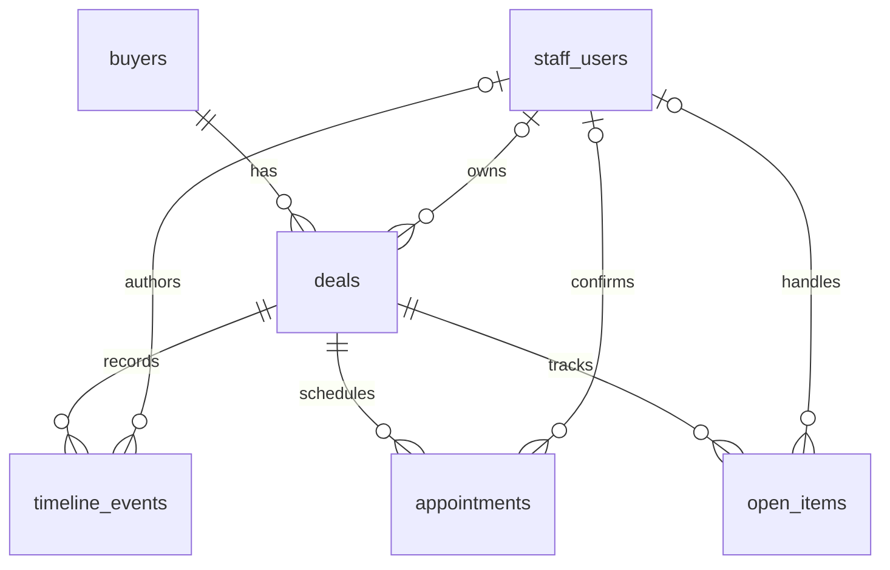

# Merto database contract: initial prototype

This documents the six tables currently implemented in PostgreSQL/Supabase.
The source of truth is `migrations/20261006000100_mvp_database.sql`. This is an
initial integration proposal, not a finalized backend API. The course demo is
one fictional dealership; store membership and multiple stores are not modeled.

## Shared conventions

- All tables live in the `public` schema and use UUID primary keys. Omitted IDs
  default to `gen_random_uuid()`; callers may provide valid UUIDs for imports.
- All timestamps are `timestamptz`. Send timestamps with an explicit offset,
  preferably UTC ISO 8601, and convert to local time for display.
- State values use the exact lowercase strings below. UI labels can differ.
- A nullable field means the information may be absent. `null` does not mean zero,
  false, or an empty string. An absent owner means unassigned.
- `created_at` defaults to database `now()`; imported events can specify their
  original time. There is no `updated_at` field or automatic audit trigger yet.
- Foreign keys use PostgreSQL's default deletion behavior: deleting referenced
  records fails while child records still reference them. There is no cascade.
- Current tables have RLS enabled and grants revoked from `anon` and
  `authenticated`. SQL Editor works using a privileged database role. There are
  no application access policies or login-to-staff mappings yet.

## Relationships

One buyer can have several deals. A deal has zero or one current owner. Events,
appointments, and tasks stay linked to the deal when the owner changes. Task
ownership is separate and must be updated explicitly when appropriate.

## Tables and fields

### `staff_users`: employees represented in the demo

| Field | Type / nullable | Meaning and rules |
| --- | --- | --- |
| `id` | UUID / no | Employee ID; not a Supabase Auth user ID. |
| `name` | text / no | Nonblank display name. |
| `role` | text / no | `gm` or `rep`; data only, not permission enforcement. |
| `email` | text / no | Unique employee email; case-sensitive uniqueness, no email-format validation. |

### `buyers`: people interested in purchasing a vehicle

| Field | Type / nullable | Meaning and rules |
| --- | --- | --- |
| `id` | UUID / no | Buyer ID, shared across that person's deals. |
| `name` | text / no | Nonblank display name. |
| `email` | text / yes | Contact email. |
| `phone` | text / yes | Contact number; no format/normalization rule yet. |
| `preferred_channel` | text / no | `email` (default), `sms`, or `call`. |
| `opted_out` | boolean / no | Current opt-out indicator; defaults to false. |
| `created_at` | timestamptz / no | Record creation time; defaults to now. |

At least one of `email` or `phone` must be non-null. The database currently allows
empty contact strings and duplicate contacts; matching the same buyer across
channels needs an agreed normalization/deduplication approach. Preferred channel
does not enforce that the matching contact field exists.

### `deals`: potential vehicle sales

| Field | Type / nullable | Meaning and rules |
| --- | --- | --- |
| `id` | UUID / no | Stable ID used by history, appointments, and tasks. |
| `buyer_id` | UUID / no | References `buyers.id`. |
| `owner_id` | UUID / yes | References `staff_users.id`; null means unassigned. |
| `vehicle_interest` | text / no | Free-text vehicle description; not an inventory integration. |
| `source` | text / no | Free-text origin, e.g. `website`, `email`, `listing_portal`. |
| `stage` | text / no | Current deal stage; defaults to `new`. |
| `lost_reason` | text / yes | Required and nonblank when stage is `lost`. |
| `created_at` | timestamptz / no | Creation time; defaults to now. |

Stages: `new`, `assigned`, `engaged`, `appointment_set`, `visited`, `working`,
`fni`, `delivered`, `lost`, `dormant`.

`delivered` and `lost` are excluded from the active-work demo queries but remain
searchable. `dormant` remains included by those queries. Unassigned is determined
by `owner_id`, not a separate stage. The database does not enforce stage transition
order or require owners to be reps rather than GMs.

### `timeline_events`: chronological messages and actions

| Field | Type / nullable | Meaning and rules |
| --- | --- | --- |
| `id` | UUID / no | Event ID. |
| `deal_id` | UUID / no | References `deals.id`. |
| `event_type` | text / no | `interaction` (default), `assignment`, `transfer`, `opt_out`, `ai_evaluation`, or `ai_review` (the last two are written by the backend evaluation service). |
| `actor_type` | text / no | `buyer`, `ai`, `rep`, `gm`, or `system`. |
| `actor_id` | UUID / yes | Staff ID for human staff events; see attribution rules below. |
| `channel` | text / no | `call`, `sms`, `email`, `web`, `in_person`, or `note`. |
| `direction` | text / no | `inbound`, `outbound`, or `internal`. |
| `body` | text / no | Nonblank message or event description. |
| `created_at` | timestamptz / no | When the event happened; defaults to now. |

For `rep`/`gm`, `actor_id` is required and references `staff_users`. For
`buyer`/`ai`/`system`, it must be null; a buyer is identified through the deal.
Actor type does not yet verify the referenced staff member's role, and there is
no authenticated attribution enforcement. Events are not automatically immutable.

Retrieve history using `order by created_at, id` for a deterministic tie-breaker.
Separate appointment/task records are not automatically rendered as timeline
events: the application action must write an event explicitly when needed.

### `appointments`: requested visits and their outcomes

| Field | Type / nullable | Meaning and rules |
| --- | --- | --- |
| `id` | UUID / no | Appointment ID. |
| `deal_id` | UUID / no | References `deals.id`. |
| `scheduled_for` | timestamptz / no | Planned visit time; not the creation/booking time. |
| `status` | text / no | `requested` (default), `confirmed`, `rescheduled`, `cancelled`, `completed`, or `no_show`. |
| `confirmed_by` | UUID / yes | References the confirming employee in `staff_users`. |
| `confirmed_at` | timestamptz / yes | Time a person confirmed the visit. |
| `outcome_note` | text / yes | Free-text visit outcome. |

`confirmed_by` and `confirmed_at` must both be null or both present. `confirmed`,
`completed`, and `no_show` require confirmation metadata. `requested` must have
none. `rescheduled` and `cancelled` permit either pair. These are record checks,
not a state-transition engine: a caller could directly insert a completed visit
with confirmation metadata. Past outcomes are not automatically recorded in history.

For a future show-rate metric, group by `scheduled_for`, not booking time.

### `open_items`: pending promises and tasks

| Field | Type / nullable | Meaning and rules |
| --- | --- | --- |
| `id` | UUID / no | Task ID. |
| `deal_id` | UUID / no | References `deals.id`. |
| `owner_id` | UUID / yes | Responsible employee; references `staff_users.id`. |
| `type` | text / no | `promise`, `missing_doc`, `unanswered_question`, or `callback`. |
| `description` | text / no | Nonblank explanation of the work. |
| `status` | text / no | `open` (default), `resolved`, or `cancelled`. |
| `due_at` | timestamptz / yes | Deadline, if known. |
| `created_at` | timestamptz / no | Creation time; defaults to now. |
| `resolved_at` | timestamptz / yes | Required exactly when status is `resolved`. |

Resolving an item means setting both `status = 'resolved'` and `resolved_at`.
Reopening or cancelling means clearing `resolved_at`. Tasks without deadlines
are allowed; in query 04 their `overdue` result is null, rather than false.

## Reads available as integration examples

The SQL in `demo/queries.sql` defines example result shapes. Hard-coded demo IDs
must become bound parameters in backend code; never interpolate user input into SQL.
The query numbers are presentation labels, not REST endpoints.

| Query | Purpose | Returned columns |
| --- | --- | --- |
| 01 | All deals with buyer, owner, and pending task count | `buyer`, `vehicle_interest`, `stage`, `owner`, `opted_out`, `open_item_count` |
| 02 | One rep's deals excluding delivered/lost | `buyer`, `vehicle_interest`, `stage` |
| 03 | One deal's chronological events | `created_at`, `actor_type`, `staff_actor`, `channel`, `direction`, `body` |
| 04 | Open tasks on deals excluding delivered/lost | `buyer`, `description`, `task_owner`, `due_at`, `overdue` |
| 05 | Appointments and confirming employee | `buyer`, `scheduled_for`, `status`, `confirmed_by` |
| 06 | Outbound messages occurring at/after an opt-out event for the same buyer | `buyer`, `body`, `created_at` |

Name columns are display values; real application responses should also include
record IDs so detail pages and updates target the right record. Counts are SQL
`bigint`; choose a consistent JSON representation in the backend.

Query 06 checks all deals for the buyer. It does not block a write, implement
re-consent, or send anything. The current boolean and event history must be kept
consistent by application actions; changing only `opted_out` will not make the
historical query detect an event that was never recorded.

## Writes and responsibilities to agree on

The backend should enforce authenticated permissions and apply related writes
atomically. The following are proposed action boundaries, not existing endpoints:

| Action | Records affected | Current boundary |
| --- | --- | --- |
| Create a buyer/deal | `buyers`, `deals`, initial `timeline_events` | Resolve existing buyer identity before inserting duplicates. |
| Assign/transfer a deal | Deal owner, relevant open-item owners, transfer event | `demo/transfer.sql` demonstrates the transaction. GM-only enforcement and structured previous/new owners are not implemented. |
| Confirm an appointment | Appointment confirmation/status, timeline entry | Staff attribution and permission checks belong to the action layer. |
| Resolve a task | Item status/resolution time, timeline entry | No automatic timeline/audit trigger yet. |
| Record an opt-out | Buyer boolean, structured `opt_out` event | Send-time suppression still needs implementation. |

Do not use the privileged SQL Editor's access as proof that browser/API access
works. Never put a database password or privileged key in frontend code. Before
integration, agree on the Auth-to-staff mapping, user versus server database
access, and authorization policies. We can propose those designs independently;
both teams need to review the shared interface.

## AI evaluation storage (proposed by the backend team)

`migrations/20261013000100_ai_evaluation.sql` adds storage only; the rules,
review workflow, and permissions live in `backend/src/evaluation/`. It is up for
review by the database team.

- `timeline_events` gains `unique (id, deal_id)` and the two event types above.
- `ai_evaluations`: `id`, `deal_id` (unique; references `deals`), `result`
  (`passed` or `flagged`), `evaluated_at`. At most one row per deal: the latest
  evaluation. No row means "not evaluated".
- `ai_flags`: `id`, `deal_id` (references `ai_evaluations.deal_id`),
  `evidence_event_id`, `flag_type` (`appointment_certainty`,
  `unsupported_availability`, `unsupported_price`, `missed_escalation`,
  `missed_price_handoff`, `ignored_opt_out`, `tone`), `severity` (`low`, `medium`, `high`), `explanation`,
  `review_status` (`pending` default, `confirmed_issue`, `false_positive`,
  `resolved`), `reviewed_by` (references `staff_users`), `reviewed_at`,
  `review_note`, `created_at`.
- `(evidence_event_id, deal_id)` references `timeline_events(id, deal_id)`, so a
  flag's evidence is always a message on the same deal.
- `(evidence_event_id, flag_type)` is unique, so re-evaluating never duplicates a flag.
- `reviewed_by` and `reviewed_at` are both null exactly when the flag is `pending`.
- RLS is enabled and `anon`/`authenticated` have no grants, as for the core tables.

`seed/seed_ai_evaluation.sql` adds the evaluation scenarios from the brief: Maya
(Deal J), Chris (Deal K), Ben (missed call, then a payment quote), Marcus (Deal C:
the AI hands a price question to a rep through an open item), and earlier AI
contact with Rob (Deal I). With it, query 01 lists 8 deals instead of 4.

## Scope and validation

No dedicated follow-up, audit, upload, trade-in, F&I, or delivery table exists yet. `fni` and `delivered` are currently only stages. Staff availability,
business hours, AI mode settings, and external integrations are not implemented.

Repeatable tests are in `tests/`; see `tests/README.md`. They exercise the real
migration, seed, demo queries, constraints, transfer rollback, and API-role/RLS
boundary in isolated PostgreSQL instances without modifying hosted Supabase.

Schema and scenario ideas were adapted from the Merto October 5 project brief;
demo data is fictional. OpenAI Codex assisted in drafting the initial SQL, this
contract, and the automated tests. Team members should review and understand these
artifacts before presenting or adopting them.
